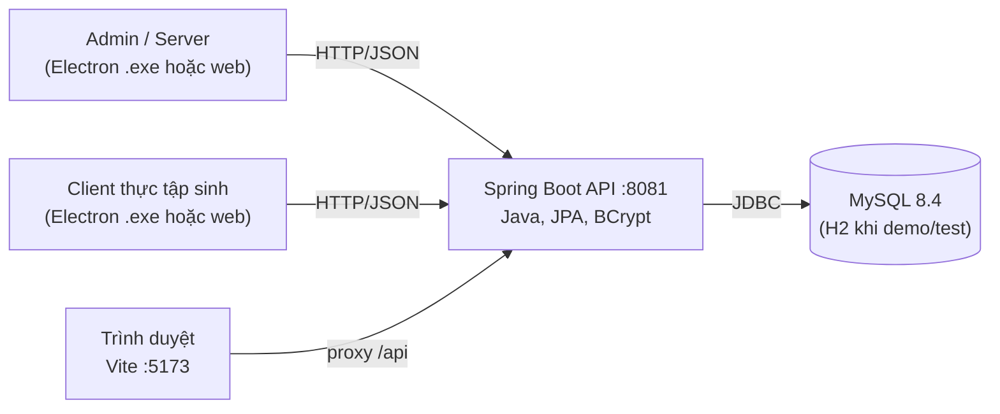
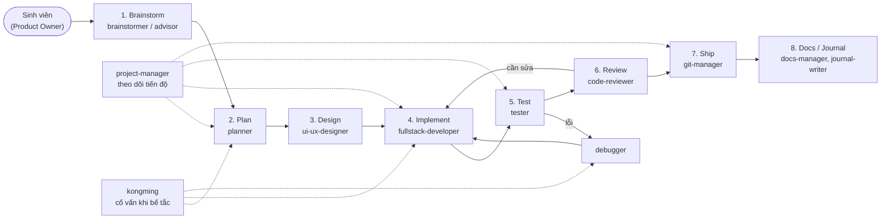

# Báo cáo: Triển khai dự án IMS bằng đội AI Agent (AgentKit)

> Môn: Quản lý dự án phần mềm (QLDAPM) · Sinh viên: Trần Việt Anh
> Dự án: **IMS – Intern Management System** (hệ thống quản lý thực tập sinh)
> Repo: `tranvietanh0/QLDAPM` · Ngày lập báo cáo: 05/11/2026
> Bộ công cụ agent: **AgentKit** (`ak` CLI 3.0.0, kit `engineer`) chạy trên Claude Code

---

## Mục lục

1. [Yêu cầu đề bài và mức độ đáp ứng](#1-yêu-cầu-đề-bài-và-mức-độ-đáp-ứng)
2. [Tổng quan dự án IMS](#2-tổng-quan-dự-án-ims)
3. [Bộ AgentKit: thành phần và cách cài](#3-bộ-agentkit-thành-phần-và-cách-cài)
4. [Đội AI Agent: vai trò, mô hình, đầu ra](#4-đội-ai-agent-vai-trò-mô-hình-đầu-ra)
5. [Quy trình triển khai dự án qua agent](#5-quy-trình-triển-khai-dự-án-qua-agent)
6. [Cơ chế điều phối và kiểm soát chất lượng](#6-cơ-chế-điều-phối-và-kiểm-soát-chất-lượng)
7. [Chạy thật: nhật ký thực hiện](#7-chạy-thật-nhật-ký-thực-hiện)
8. [Kết quả agent Tester](#8-kết-quả-agent-tester)
9. [Kết quả agent Code Reviewer](#9-kết-quả-agent-code-reviewer)
10. [Dự án còn thiếu gì và kế hoạch tiếp theo](#10-dự-án-còn-thiếu-gì-và-kế-hoạch-tiếp-theo)
11. [Kịch bản video demo](#11-kịch-bản-video-demo)
12. [Đánh giá, hạn chế và bài học](#12-đánh-giá-hạn-chế-và-bài-học)
13. [Phụ lục: lệnh và đường dẫn](#13-phụ-lục-lệnh-và-đường-dẫn)

---

## 1. Yêu cầu đề bài và mức độ đáp ứng

Đề bài gồm bốn yêu cầu. Bảng dưới ghi rõ yêu cầu nào đã xong và bằng chứng nằm ở đâu.

| # | Yêu cầu | Trạng thái | Bằng chứng |
|---|---|---|---|
| 1 | Xây dựng dự án từ các AI Agent (PM, coding, reviewer, tester, designer…) | Đã có đội agent và quy trình; agent review và test đã chạy thật trên mã nguồn | Mục 3–6; `.claude/agents/`; báo cáo agent trong `plans/reports/` |
| 2 | Viết báo cáo | Tài liệu này | `docs/bao-cao-trien-khai-ims-bang-ai-agent.md` |
| 3 | Chạy thật một dự án (hoặc một module) | Ứng dụng IMS chạy thật với MySQL; agent chạy thật trên repo | Mục 7, 8, 9 |
| 4 | Video demo | Chưa quay; đã có kịch bản | Mục 11 |

---

## 2. Tổng quan dự án IMS

IMS số hóa quy trình quản lý thực tập sinh: tiếp nhận, phân mentor, giao việc, báo cáo tuần, đánh giá cuối kỳ.

**Kiến trúc:**



| Tầng | Công nghệ | Thư mục |
|---|---|---|
| Backend | Spring Boot 3.3.4, Spring Data JPA, Bean Validation, BCrypt | `app/backend` |
| Frontend | React + Vite | `app/frontend` |
| Desktop | Electron (bản Admin/Server và bản Client) | `app/desktop`, `app/scripts` |
| CSDL | MySQL 8 (thật), H2 chế độ MySQL (demo và test) | `app/database` |
| Tài liệu gốc | Tổng quan, BA, kế hoạch PM, API contract, test plan, kịch bản demo | `app/docs/01..07` |

**Vai trò người dùng:** ADMIN (quản trị, cấp tài khoản, giao việc), MENTOR (hướng dẫn, chấm báo cáo, đánh giá), INTERN (nhận việc, cập nhật tiến độ, nộp báo cáo tuần).

**Yêu cầu nghiệp vụ chính:** 6 user story (US01–US06) và 8 business rule (BR01–BR08) trong `app/docs/02-ba-requirements.md`; 18 test case (TC01–TC18) trong `app/docs/05-testing.md`.

---

## 3. Bộ AgentKit: thành phần và cách cài

### 3.1 AgentKit là gì

AgentKit là bộ công cụ biến Claude Code thành **một đội phát triển phần mềm nhiều agent**. Bộ gồm hai phần:

- **CLI `ak`**: cài, cập nhật, kiểm tra sức khỏe (`ak doctor`), quản lý kit, plan, journal, backup.
- **Kit `engineer`**: nội dung được cài vào dự án, gồm agent, skill, rule và hook.

### 3.2 Thành phần đã cài vào dự án

| Thành phần | Số lượng | Vị trí | Vai trò |
|---|---|---|---|
| Agent (subagent) | 16 | `.claude/agents/*.md` | "Nhân sự" của đội: mỗi agent có mô tả, mô hình AI và bộ công cụ riêng |
| Skill | 105 | `.claude/skills/` | "Quy trình chuẩn" (SOP) gọi bằng `/ak-<tên>`: plan, cook, code-review, test, ship… |
| Rule | 8 | `.claude/rules/*.md` | Luật chung cho mọi agent: quy trình, review, điều phối, quản lý tiến trình |
| Hook | 18 script, gắn vào 27 điểm sự kiện | `.claude/hooks/`, `.claude/settings.json` | Rào chắn tự động chạy trước/sau mỗi thao tác |
| Cấu hình dự án | 1 | `.agentkit/config.yaml` | Đường dẫn plan, report, docs, quy tắc đặt tên |

### 3.3 Cách cài (đã thực hiện thật)

```bash
ak init                        # khởi tạo và đăng ký dự án vào registry của AgentKit
ak kit install engineer --yes  # cài kit engineer vào dự án (1869 file)
ak doctor                      # kiểm tra: 24 OK, 0 lỗi
```

Bản cài chung cho cả máy cũng được sửa lỗi đăng ký hook bằng
`ak kit init engineer --remote --target claude-code --global --force`. AgentKit tự lưu bản sao lưu trước khi ghi đè
(`ak backups restore 20261105T025535Z-c8434883` để quay lại).

---

## 4. Đội AI Agent: vai trò, mô hình, đầu ra

### 4.1 Ánh xạ vai trò dự án sang agent

Kế hoạch gốc (`app/docs/03-pm-plan.md`) cần đội 5 người: PM, BA, FE, BE, Tester. Với AgentKit, mỗi vai trò do một hoặc vài agent đảm nhận. Sinh viên giữ vai trò **Product Owner và người phê duyệt cuối**.

| Vai trò trong đội | Agent AgentKit | Mô hình | Đầu ra chính |
|---|---|---|---|
| **PM** – quản lý tiến độ, phạm vi | `project-manager` | Opus | Theo dõi trạng thái plan, báo cáo tiến độ, điều phối giữa các phiên |
| **PM** – lập kế hoạch | `planner` | Opus | Plan nhiều phase trong `plans/`, có tiêu chí nghiệm thu |
| **BA** – phân tích, chốt yêu cầu | `brainstormer`, `researcher`, `advisor` | Opus / Fable | Phương án so sánh, nghiên cứu công nghệ, phỏng vấn chốt phạm vi |
| **Designer** – UI/UX | `ui-ux-designer` | Opus | Wireframe, design system, layout responsive |
| **Coder** – FE + BE | `fullstack-developer` | Opus | Mã nguồn theo từng phase, có ranh giới file rõ ràng |
| **Reviewer** | `code-reviewer`, `code-simplifier` | Opus | Báo cáo review (bảo mật, lỗi, khả năng bảo trì), đề xuất làm gọn mã |
| **Tester / QA** | `tester`, `debugger` | Haiku / Opus | Chạy test, build, smoke API; truy vết nguyên nhân lỗi |
| **DevOps / Git** | `git-manager` | Haiku | Commit theo conventional commits, push, quét lộ bí mật |
| **Technical writer** | `docs-manager`, `journal-writer` | Opus | Tài liệu dự án, nhật ký kỹ thuật |
| **Cố vấn kỹ thuật** | `kongming` | Fable | Lời khuyên một lần cho quyết định khó (chỉ tư vấn, không viết mã) |
| **Trinh sát mã** | `explore` | Haiku | Tìm file, lần quan hệ, tóm tắt ngữ cảnh nhanh |

**Nguyên tắc chọn mô hình:** việc lặp lại, chi phí thấp (chạy test, commit, tìm file) dùng Haiku. Việc cần suy luận (lập kế hoạch, viết mã, review) dùng Opus. Quyết định khó hoặc bế tắc mới gọi Fable qua `kongming` hoặc `advisor`.

### 4.2 Skill tương ứng từng vai trò

Agent là "người", skill là "quy trình người đó làm theo". Các skill chính dùng trong dự án:

| Giai đoạn | Skill | Việc làm |
|---|---|---|
| Chốt yêu cầu | `/ak-brainstorm`, `/ak-advise` | Biến ý tưởng mơ hồ thành kết quả, ràng buộc, tiêu chí nghiệm thu |
| Lập kế hoạch | `/ak-plan` | Tạo plan nhiều phase, kiểm tra và red-team plan |
| Thiết kế | `/ak-frontend-design`, `/ak-ui-ux-pro-max`, `/ak-databases` | Giao diện, design system, lược đồ CSDL |
| Lập trình | `/ak-cook`, `/ak-backend-development`, `/ak-frontend-development` | Hiện thực plan đã duyệt |
| Kiểm thử | `/ak-test`, `/ak-web-testing`, `/ak-scenario` | Chạy test, sinh ca kiểm thử biên |
| Sửa lỗi | `/ak-debug`, `/ak-fix` | Chứng minh nguyên nhân rồi mới sửa |
| Review | `/ak-code-review`, `/ak-security` | Review theo bằng chứng, rà bảo mật |
| Phát hành | `/ak-git`, `/ak-ship` | Commit, push, mở PR, chờ CI |
| Tài liệu, báo cáo | `/ak-docs`, `/ak-journal`, `/ak-sumup` | Tài liệu dự án, nhật ký, tổng kết |
| Quản lý | `/ak-project-management`, `/ak-plans-kanban`, `/ak-watzup` | Theo dõi tiến độ, bảng kanban plan |
| Đội nhiều phiên | `/ak-team`, `/ak-orchestrate`, `/ak-vibe` | Chạy song song nhiều agent/phiên, pipeline tự động đến PR |

---

## 5. Quy trình triển khai dự án qua agent

### 5.1 Pipeline chuẩn của AgentKit

Quy trình lấy từ rule `.claude/rules/skill-workflow-routing.md` và `primary-workflow.md`:



Quy trình sửa lỗi đi theo nhánh riêng: **khung kết quả → trinh sát → chẩn đoán → chọn cách sửa → sửa → test → review**. Luật bắt buộc là phải chứng minh được nguyên nhân trước khi sửa.

### 5.2 Ánh xạ Sprint của dự án sang agent

Kế hoạch 5 Sprint trong `app/docs/03-pm-plan.md` khi chạy bằng AgentKit:

| Sprint | Nội dung | Agent và skill chính | Cổng chất lượng |
|---|---|---|---|
| 0 – Khởi động | Chốt scope, WBS, công nghệ | `advisor` (`/ak-advise`), `planner` (`/ak-plan`) | Plan có tiêu chí nghiệm thu, sinh viên duyệt |
| 1 – Nền tảng | Repo, đăng nhập, phân quyền, User/Department | `fullstack-developer` (`/ak-cook`), `tester` | `mvn test` pass, review không còn lỗi Critical |
| 2 – Quản lý thực tập sinh | CRUD intern, phân mentor | `ui-ux-designer`, `fullstack-developer`, `code-reviewer` | TC03–TC05 pass |
| 3 – Giao việc | Tạo task, luồng trạng thái, ràng buộc deadline | `fullstack-developer`, `tester` (`/ak-scenario`) | TC06–TC11 pass, BR04–BR07 đúng |
| 4 – Báo cáo và đánh giá | Báo cáo tuần, review của mentor, đánh giá cuối kỳ | `fullstack-developer`, `code-reviewer` (`/ak-security`) | TC12–TC18 pass |
| 5 – Dashboard và QA | Dashboard, regression, dữ liệu demo, phát hành | `tester`, `git-manager` (`/ak-ship`), `docs-manager` | Definition of Done đạt, tài liệu cập nhật |

### 5.3 Mẫu giao việc cho một agent

Mỗi lần giao việc, agent điều phối (phiên Claude Code chính) gửi một "phiếu giao việc" theo rule `orchestration-protocol.md`. Phiếu luôn có các mục sau:

- **Task**: việc cần làm.
- **Files to read / may modify**: đọc file nào, được sửa file nào. Mục này giúp các agent chạy song song không giẫm lên nhau.
- **Acceptance criteria**: tiêu chí nghiệm thu.
- **Constraints**: ràng buộc, ví dụ "không ghi vào CSDL thật".
- **Reports path**: báo cáo ghi vào `plans/reports/`.

Agent kết thúc bằng một dòng trạng thái chuẩn:
`Status: DONE | DONE_WITH_CONCERNS | BLOCKED | NEEDS_CONTEXT`. Nếu agent báo `BLOCKED` hoặc `NEEDS_CONTEXT`, điều phối viên phải đổi ngữ cảnh hoặc cách làm, không được lặp lại y nguyên.

---

## 6. Cơ chế điều phối và kiểm soát chất lượng

### 6.1 Rule: luật chung cho cả đội

| Rule | Nội dung chính |
|---|---|
| `primary-workflow.md` | 5 bước: chốt kết quả → khảo sát → lập kế hoạch và làm → kiểm chứng → review và kết thúc |
| `development-rules.md` | KISS, DRY; không dùng dữ liệu giả để qua test; không giấu lỗi test, lint, build; không commit bí mật |
| `review-audit-self-decision.md` | Không lật ngược quyết định đã kiểm chứng nếu không có bằng chứng mới; không tự ý đảo quyết định của người dùng |
| `orchestration-protocol.md` | Phiếu giao việc, cô lập ngữ cảnh, quy tắc chạy song song, giao thức trạng thái |
| `process-management.md` | Theo dõi và dọn tiến trình nền (dev server), không để tiến trình "ma" |
| `documentation-management.md` | Chỉ cập nhật tài liệu khi có thay đổi hành vi, thiết lập hoặc kiến trúc |

### 6.2 Hook: rào chắn tự động

Hook là script chạy **tự động** ở các thời điểm cố định, agent không thể bỏ qua.

| Thời điểm | Hook tiêu biểu | Tác dụng |
|---|---|---|
| Trước khi chạy lệnh hoặc đọc file | `privacy-block`, `scout-block`, `context-firewall` | Chặn đọc file nhạy cảm, chặn quét thư mục build nặng (`node_modules`, `target`…) để tiết kiệm ngữ cảnh |
| Trước khi chạy lệnh mạng | `secrets-inject` | Đưa bí mật vào lệnh mà không in ra màn hình |
| Trước khi ghi file | `descriptive-name` | Buộc tên file mô tả rõ, dạng kebab-case |
| Khi người dùng gửi yêu cầu | `dev-rules-reminder`, `secret-output-guardrail`, `simplify-gate` | Nhắc luật, đường dẫn plan/report, cấm in bí mật |
| Sau khi sửa file | `plan-format-kanban` | Giữ định dạng plan để hiện lên bảng kanban |
| Khi subagent bắt đầu | `subagent-init`, `team-context-inject` | Bơm ngữ cảnh dự án cho agent con |
| Khi phiên dừng hoặc nén ngữ cảnh | `session-state`, `precompact-capture`, `cook-after-plan-reminder` | Lưu trạng thái để làm tiếp, nhắc hiện thực plan đã lập |

**Ví dụ thật:** khi chạy lại backend bằng `java -jar target/...jar`, hook `scout-block` đã chặn lệnh vì chứa từ `target`. Điều phối viên chuyển sang lệnh `mvn spring-boot:run` (cách chạy chuẩn trong README) thay vì lách hook.

### 6.3 Cổng chất lượng (Definition of Done khi làm với agent)

Một hạng mục chỉ được coi là xong khi:

1. `tester` báo build và test pass, kèm số liệu thật (không ghi "pass" nếu chưa chạy).
2. `code-reviewer` không còn lỗi Critical hoặc High chưa xử lý.
3. Sinh viên (Product Owner) đã xem và duyệt.
4. `git-manager` commit theo conventional commits, không chứa bí mật.
5. Tài liệu liên quan được cập nhật nếu hành vi người dùng thay đổi.

---

## 7. Chạy thật: nhật ký thực hiện

Phần này ghi lại những gì **đã thực sự chạy** ngày 05/11/2026, theo thứ tự thời gian.

| # | Việc | Ai làm | Kết quả |
|---|---|---|---|
| 1 | Đưa mã nguồn IMS vào repo (bỏ `node_modules`, thư mục build, file `.exe` khoảng 1,5 GB, CSDL mẫu) | Điều phối viên (Claude Code) | 87 file trong `app/` (kèm `.gitignore` mới); commit `4ec5e99` (88 file, 8123 dòng), đã push |
| 2 | Build và test backend | Điều phối viên | Build bằng JDK 17 (pom khai báo 21) và Maven 3.9.9; 3/3 test pass |
| 3 | Chạy ứng dụng | Điều phối viên | API `:8081` báo `status=UP`, `database=MySQL`; web `:5173`; đăng nhập 3 vai trò thành công |
| 4 | Xử lý sự cố "Server cần MySQL của XAMPP" | Điều phối viên + sinh viên duyệt | Giao diện chặn khi backend dùng H2; chuyển sang MySQL 8.4 sẵn có; sinh viên chọn xóa và tạo lại CSDL cũ |
| 5 | Cài AgentKit vào dự án | Điều phối viên + sinh viên | `ak init`, `ak kit install engineer`; `ak doctor` 0 lỗi |
| 6 | Kiểm thử toàn diện | Agent **`tester`** (Haiku) | Báo cáo `plans/reports/tester-261105-1002-ims-test-report.md` (mục 8) |
| 7 | Review toàn bộ mã | Agent **`code-reviewer`** (Opus), chạy song song với `tester` | Báo cáo `plans/reports/code-reviewer-261105-1002-ims-full-review.md` (mục 9) |
| 8 | Viết báo cáo này | Điều phối viên, dựa trên báo cáo của các agent | `docs/bao-cao-trien-khai-ims-bang-ai-agent.md` |

**Hai agent chạy song song.** `tester` và `code-reviewer` nhận phiếu giao việc riêng, chỉ được ghi vào file báo cáo của mình, nên không xung đột. Cả hai bị cấm sửa mã nguồn. `tester` còn bị cấm ghi vào CSDL thật, ngoài thao tác đăng nhập.

---

## 8. Kết quả agent Tester

Nguồn: `plans/reports/tester-261105-1002-ims-test-report.md`. Agent dùng 19 lượt công cụ, chạy khoảng 3,4 phút.

### 8.1 Số liệu

| Hạng mục | Lệnh | Kết quả |
|---|---|---|
| Test backend | `mvn -B -Djava.version=17 test` | **3/3 pass**, 0 fail, 0 error (`ApiIntegrationTest` 2, `AdminInternFlowTest` 1), 11,6 giây, chạy trên H2 |
| Build frontend | `npm run build` | **Thành công**, 36 module, JS 214,28 kB (gzip 66,99 kB), CSS 20,65 kB, không cảnh báo |
| Smoke API chỉ đọc | `curl` vào `:8081` | **53/55 pass** |

### 8.2 Kiểm tra API đáng chú ý

- Không có token hoặc token sai: cả 11 endpoint được kiểm tra đều trả **401**.
- ADMIN, MENTOR và INTERN đều đọc được `/api/auth/me`, dashboard, mentors, departments, interns, tasks, reports, evaluations (**200**). Dữ liệu được lọc theo vai trò.
- `/api/tasks/my-tasks` trả **403** cho ADMIN và MENTOR, **200** cho INTERN.
- Đăng nhập sai mật khẩu trả **401**. Đăng nhập sai cổng (portal) trả **403**.

### 8.3 Hai lỗi thật phát hiện được

| Lỗi | Mong đợi | Thực tế | Nguyên nhân |
|---|---|---|---|
| `GET /api/does-not-exist` | 404 | **500** | `@ExceptionHandler(Exception.class)` trong `ApiExceptionHandler.java` bắt cả `NoResourceFoundException` |
| `GET /api/admin/departments` (sai method) | 405 | **500** | Bắt luôn `HttpRequestMethodNotSupportedException` |

Hai lỗi không làm lộ stack trace, nhưng trả sai mã lỗi khiến client và người kiểm thử hiểu nhầm là lỗi máy chủ.

### 8.4 Khoảng trống kiểm thử

- Chưa có công cụ đo độ phủ (JaCoCo), nên chưa có số liệu coverage.
- Chưa có test tự động cho: sửa/xóa intern, xóa task, sửa/xóa báo cáo, sửa/xóa phòng ban và mentor, đăng xuất, đổi mật khẩu, nhánh dashboard của mentor.
- Trong 18 test case, **TC04, TC05, TC08, TC10, TC13, TC15, TC18 chưa có test tự động**. TC10 chính là test hồi quy cho BUG-001 (TODO → COMPLETED).
- Frontend chưa có test, lint hay typecheck.
- Toàn bộ test chạy trên H2, chưa có test trên MySQL thật.

---

## 9. Kết quả agent Code Reviewer

Nguồn: `plans/reports/code-reviewer-261105-1002-ims-full-review.md`. Agent dùng 16 lượt công cụ, chạy khoảng 6,2 phút. Mỗi phát hiện trong báo cáo gốc đều có file:dòng, mức độ, kịch bản lỗi và cách sửa. Điều phối viên đã tự đọc lại code để xác minh cả ba lỗi High.

### 9.1 Tổng hợp

| Mức độ | Số lượng |
|---|---|
| Critical | 0 |
| High | 3 |
| Medium | 9 |
| Low | 13 |
| **Tổng** | **25** |

**Điểm tốt về bảo mật:** không có lỗi IDOR. Agent đã kiểm tra mọi endpoint đọc và ghi của task, báo cáo, đánh giá và hồ sơ: thực tập sinh không đọc hay sửa được dữ liệu của thực tập sinh khác. Mật khẩu được băm bằng BCrypt. Token phiên là chuỗi ngẫu nhiên 32 byte và CSDL chỉ lưu giá trị băm của token.

### 9.2 Ba lỗi High

| # | Lỗi | Vị trí | Hậu quả | Hướng sửa |
|---|---|---|---|---|
| H1 | Tài khoản mặc định dùng mật khẩu `123456`, và màn hình đăng nhập Admin in sẵn mật khẩu này | `DataSeeder.java:18-20`, `App.jsx:87,114`; API nghe trên `0.0.0.0` (`application.properties:3`) | Bất kỳ máy nào trong mạng LAN cũng lấy được quyền ADMIN chỉ bằng một request. Mật khẩu này còn vi phạm chính quy tắc tối thiểu 8 ký tự của hệ thống | Chỉ seed tài khoản ở profile demo, buộc đổi mật khẩu ở lần đăng nhập đầu, bỏ dòng hiện mật khẩu trên UI |
| H2 | Mentor không dùng được ứng dụng: chỉ có hai cổng ADMIN và INTERN | `portal.js:1-3`, `AuthService.java:40` | Mentor đăng nhập ở cổng nào cũng bị 403, nên US03, US05, US06 không dùng được qua giao diện. Hiện chỉ Admin thao tác thay | Cần quyết định nghiệp vụ: thêm cổng Mentor, hoặc cho cổng Admin nhận cả MENTOR |
| H3 | Bộ xử lý lỗi "nuốt" mọi exception và không ghi log | `ApiExceptionHandler.java:25-26` | Lỗi 404, 405, 415 đều bị trả thành 500 (khớp với 2 lỗi agent tester tìm thấy). Không có log nên không debug được | Xử lý riêng `NoResourceFoundException`, `HttpRequestMethodNotSupportedException`, `HttpMediaTypeNotSupportedException`; ghi log ở handler chung |

**Hai agent độc lập cho cùng kết quả:** agent tester phát hiện H3 bằng cách chạy thật API, còn agent code-reviewer phát hiện bằng cách đọc code. Hai bằng chứng từ hai phía khớp nhau, nên độ tin cậy của phát hiện này cao.

### 9.3 Lỗi Medium

| # | Nội dung |
|---|---|
| M1 | Không giới hạn số lần đăng nhập sai, nên có thể dò mật khẩu |
| M2 | Token và mật khẩu đi qua HTTP thuần trong LAN; cấu hình mặc định dùng tài khoản DB `root` với mật khẩu rỗng |
| M3 | `rating` và các điểm đánh giá là kiểu `double` nguyên thủy, nên khi request thiếu trường thì lặng lẽ thành 0 (`ReportController.java:14`, `EvaluationController.java:13`) |
| M4 | `pom.xml` yêu cầu Java 21 nhưng code không dùng tính năng nào của Java 21; máy chỉ có JDK 17 |
| M5 | Chỉ có 3 phương thức test, chưa có CI |
| M6 | Lược đồ CSDL dựa vào `ddl-auto=update`, không có công cụ migration (Flyway) |
| M7 | Bản Client `.exe` luôn gọi `127.0.0.1:8081` (`main.cjs:8`), không cấu hình được IP máy chủ khi chạy trên LAN |
| M8 | `App.jsx` dồn hết vào một file 49,7 KB, có dòng dài hơn 4.000 ký tự, chưa có lint |
| M9 | Truy vấn N+1 do quan hệ EAGER kết hợp `findAll`, cộng với polling mỗi 10 giây |

### 9.4 Lỗi Low (13 mục)

Gồm: mất cập nhật khi tính `progress` đồng thời; phiên hết hạn không được dọn; dò email qua thời gian phản hồi; trạng thái STOPPED không chặn thao tác của intern; rút ngắn kỳ thực tập có thể làm deadline task vi phạm BR04; xóa phòng ban không tồn tại vẫn trả 200; hàm `today()` dùng UTC thay vì giờ Việt Nam; tài liệu lệch code (`app/docs/04` và hướng dẫn H2 trong README); thiếu kiểm tra độ dài `completionNote`; form sửa đánh giá có thể ghi đè đánh giá người khác; chính sách mật khẩu yếu; `/api/mentors` lộ email mentor cho intern; còn code chết (`ServerLauncher.cs`, `countByStatus`).

---

## 10. Dự án còn thiếu gì và kế hoạch tiếp theo

### 10.1 Những gì còn thiếu

Tổng hợp từ báo cáo của hai agent và từ quá trình chạy thật:

| Nhóm | Còn thiếu | Mức ưu tiên |
|---|---|---|
| Nghiệp vụ | Mentor chưa có giao diện (H2) | Cao, cần sinh viên quyết định |
| Bảo mật | Mật khẩu mặc định hiện trên UI (H1); không giới hạn đăng nhập sai (M1); chưa dùng HTTPS (M2) | Cao |
| Chất lượng | Handler lỗi trả 500 sai mã và không ghi log (H3) | Cao |
| Kiểm thử | Mới có 3 test; 7 test case (TC04, TC05, TC08, TC10, TC13, TC15, TC18) chưa tự động hóa; chưa đo coverage; frontend chưa có test | Cao |
| Quy trình | Chưa có CI (GitHub Actions) chạy test mỗi lần push | Trung bình |
| Môi trường | Lệch phiên bản Java (21 trong pom, 17 trên máy); chưa có migration CSDL | Trung bình |
| Đóng gói | Client `.exe` không cấu hình được IP máy chủ (M7) | Trung bình |
| Bảo trì | `App.jsx` quá lớn, chưa có lint | Thấp |
| Đề bài | Chưa quay video demo; chưa chạy vòng lặp agent coder → tester → reviewer trên một lỗi cụ thể | Cao (để nộp bài) |

### 10.2 Kế hoạch tiếp theo theo đội agent

Thứ tự đề xuất. Mỗi bước là một vòng lặp đầy đủ của đội agent, nên cũng chính là phần "chạy thật" có thể quay video:

| Bước | Việc | Agent | Tiêu chí xong |
|---|---|---|---|
| 1 | Sửa H3: trả đúng 404/405/415 và ghi log | `fullstack-developer` → `tester` → `code-reviewer` → `git-manager` | Smoke API 55/55 pass; có test mới cho 404 và 405 |
| 2 | Thêm test cho TC04, TC05, TC08, TC10, TC13, TC15, TC18 | `tester` (`/ak-scenario`, `/ak-test`) | 7 test case mới có test tự động và pass |
| 3 | Sửa H1: chỉ seed tài khoản ở profile demo, bỏ hiện mật khẩu, thêm giới hạn đăng nhập sai | `fullstack-developer`, `code-reviewer` (`/ak-security`) | Review lại không còn High về bảo mật |
| 4 | Quyết định và làm cổng Mentor (H2) | `brainstormer` → `ui-ux-designer` → `fullstack-developer` | Mentor đăng nhập được, làm được US03, US05, US06 qua UI |
| 5 | Thêm CI GitHub Actions và JaCoCo | `planner`, `git-manager` (`/ak-ship`) | CI xanh trên `main` |
| 6 | Quay video demo theo mục 11 | Sinh viên | Video 6–8 phút |

---

## 11. Kịch bản video demo

Video dài khoảng 6–8 phút, quay màn hình, gồm 3 phần.

**Phần 1 – Đội agent (khoảng 2 phút)**

1. Mở thư mục `.claude/agents/`, giới thiệu 16 agent và vai trò (dùng bảng mục 4.1).
2. Chạy `ak doctor` cho thấy kit đã cài, 0 lỗi.
3. Mở `.claude/settings.json` hoặc gõ thử một lệnh bị hook chặn, cho thấy rào chắn tự động.

**Phần 2 – Agent làm việc thật (khoảng 3 phút)**

1. Trong Claude Code, giao việc: "review toàn bộ app và chạy test". Cho thấy `code-reviewer` và `tester` chạy song song.
2. Mở hai báo cáo trong `plans/reports/`, chỉ ra lỗi 500 thay vì 404/405 và các phát hiện của reviewer.
3. (Nếu đã làm bước tiếp theo ở mục 10) Giao `fullstack-developer` sửa một lỗi, `tester` chạy lại test, `git-manager` commit. Đây là vòng lặp đầy đủ coder → tester → reviewer.

**Phần 3 – Ứng dụng chạy thật (khoảng 2–3 phút)**

1. Chạy backend với MySQL và web (lệnh ở mục 13). Mở `http://localhost:8081/api/health`.
2. Đăng nhập Admin: tạo thực tập sinh, giao task.
3. Đăng nhập Intern: chuyển task TODO → IN_PROGRESS, thử TODO → COMPLETED để thấy bị chặn, nộp báo cáo tuần.
4. Đăng nhập Mentor (hoặc Admin): chấm báo cáo, xem dashboard.

---

## 12. Đánh giá, hạn chế và bài học

### 12.1 Điểm làm được

- Có đủ "đội" agent cho mọi vai trò mà đề bài yêu cầu (PM, coding, reviewer, tester, designer), kèm quy trình, luật và rào chắn tự động rõ ràng.
- Agent chạy **thật** trên mã nguồn thật, ra báo cáo có số liệu, và tìm được lỗi thật (500 thay vì 404/405), không phải dữ liệu minh họa.
- Ứng dụng chạy end-to-end với MySQL, cả 3 vai trò đăng nhập được.

### 12.2 Hạn chế (ghi trung thực)

- **Mã nguồn IMS không do agent viết từ đầu trong đợt này.** Mã được đưa vào từ bản đã có (commit `4ec5e99`). Trong đợt này, agent mới đảm nhận các vai trò review, test và báo cáo. Vòng lặp coder → tester → reviewer trên một lỗi cụ thể là bước tiếp theo (mục 10).
- Máy chỉ có JDK 17 trong khi `pom.xml` khai báo Java 21. Dự án build được với JDK 17 nhưng chưa kiểm chứng trên JDK 21.
- Chưa quay video demo.
- Bản desktop Electron (`npm run sever`, `npm run client`) chưa được đóng gói lại và chạy thử trong đợt này. Đợt này chỉ chạy bản web.

### 12.3 Bài học khi làm việc với đội agent

1. **Phiếu giao việc rõ thì kết quả tốt.** Ghi rõ được sửa file nào, cấm gì, tiêu chí nghiệm thu là gì, thì agent làm đúng phạm vi và không đụng vào dữ liệu thật.
2. **Bắt agent ghi bằng chứng.** Tester báo số liệu thô và lệnh đã chạy, nên kết quả kiểm chứng lại được.
3. **Con người vẫn là người quyết định.** Các quyết định không đảo ngược được (xóa CSDL, ghi đè cấu hình chung của máy) đều phải hỏi sinh viên trước.
4. **Chọn mô hình theo độ khó** để tiết kiệm chi phí: Haiku cho việc lặp lại, Opus cho suy luận, Fable cho quyết định khó.

---

## 13. Phụ lục: lệnh và đường dẫn

### 13.1 Chạy ứng dụng (Windows, Git Bash)

```bash
# Backend với MySQL (mật khẩu đặt qua biến môi trường, không ghi vào repo)
cd app/backend
DB_USER=root DB_PASSWORD=<mật_khẩu_mysql> mvn -Djava.version=17 spring-boot:run

# Backend với H2 (không cần MySQL; lưu ý giao diện web chỉ chấp nhận MySQL/MariaDB)
mvn -Djava.version=17 spring-boot:run -Dspring-boot.run.profiles=demo

# Frontend web (terminal khác)
cd app/frontend && npm install && npm run dev
# Mở http://localhost:5173
```

Tài khoản demo: `admin@gmail.com`, `mentor@gmail.com`, `intern@gmail.com`. Mật khẩu mẫu ghi trong `app/README.md`; cần đổi sau khi thử nghiệm.

### 13.2 AgentKit

```bash
ak doctor                       # kiểm tra sức khỏe
ak kit install engineer --yes   # cài kit vào dự án
ak backups restore <backup-id>  # quay lại bản trước khi ghi đè
```

### 13.3 Đường dẫn quan trọng

| Nội dung | Đường dẫn |
|---|---|
| Mã nguồn ứng dụng | `app/` |
| Tài liệu gốc của ứng dụng | `app/docs/01..07` |
| Quy trình làm việc theo vai trò (Jira) | `docs/WORKFLOW.md` |
| Agent | `.claude/agents/` |
| Rule | `.claude/rules/` |
| Hook | `.claude/hooks/`, `.claude/settings.json` |
| Báo cáo của agent | `plans/reports/` |
